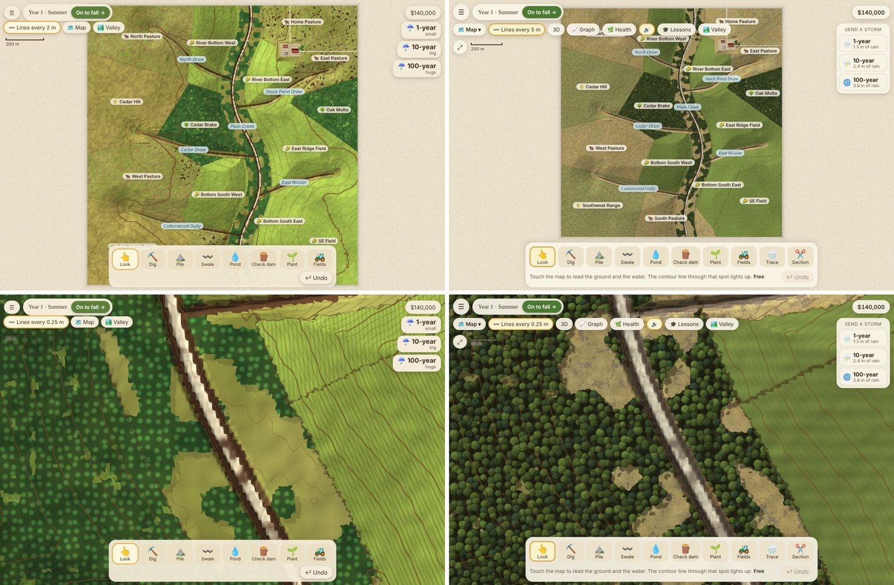

# Creek Care

A creek and stormwater sandbox in the browser. You inherit a 500-acre North Texas ranch with an incised creek and five eroding
gullies. Dig swales and ponds, build check dams, plant grass, trees and willows, change how each field is farmed, then send a
1-, 10- or 100-year storm and watch where the water goes, what soil it takes and what it builds. Zoom out to the whole valley and
let decades go by: banks wear back, bends slide downstream and cut-off loops become oxbow lakes, while cut-down creeks either
heal or get worse.

The water runs on the graphics chip (shallow-water "virtual pipes" with Manning drag, soaking in, sediment pick-up and drop, bank
slumping held by roots). The valley view is a reduced-complexity fluvial geomorphology model (compound-channel hydraulics,
Meyer-Peter and Muller bedload, bank retreat and mass failure, meander migration and cutoffs, channel-evolution stages).



## Play

Serve the folder with any static web host and open `index.html`, for example:

```
python3 -m http.server
```

then go to `http://localhost:8000`. It needs WebGL2 (recent Chrome, Edge, Safari 15+ or Firefox). It works with a mouse or a
touch screen. Press **?** in the game for the keys.

Address options: `?free=1` skips the title card, `?level=0..3` forces a detail level (0 = 1 m cells, 3 = 4 m cells),
`?quick=1` makes storms short, `?tour=0` never shows the tour by itself.

## More

- `NOTES.md`: how the game is put together, the folder map and what still needs checking.
- `docs/EXTENSION_API.md`: how feature modules plug in.
- `docs/RIVER_SCALE.md`: the valley model.
- `python3 tools/bundle.py out.html --embed` packs everything into one file that opens straight from disk, on a computer or a phone.
